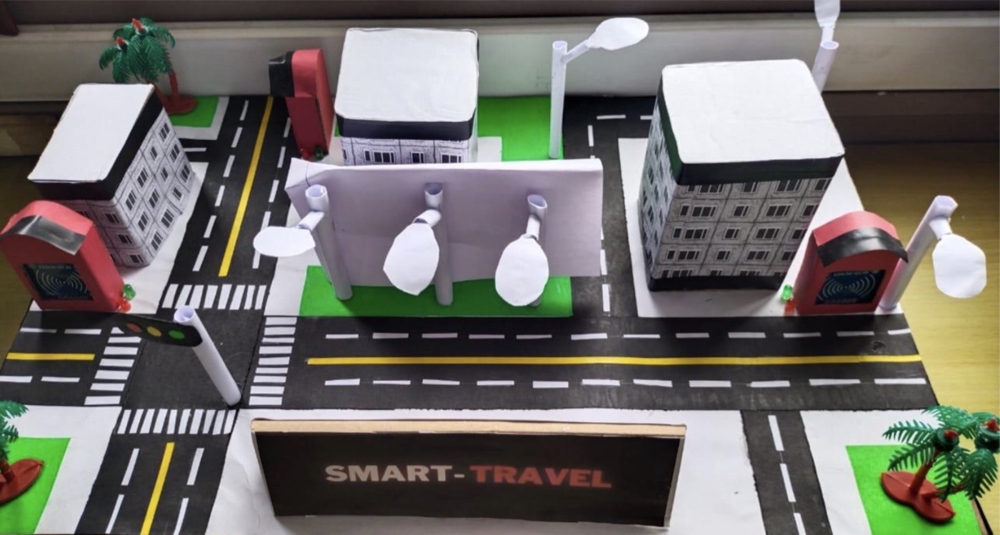
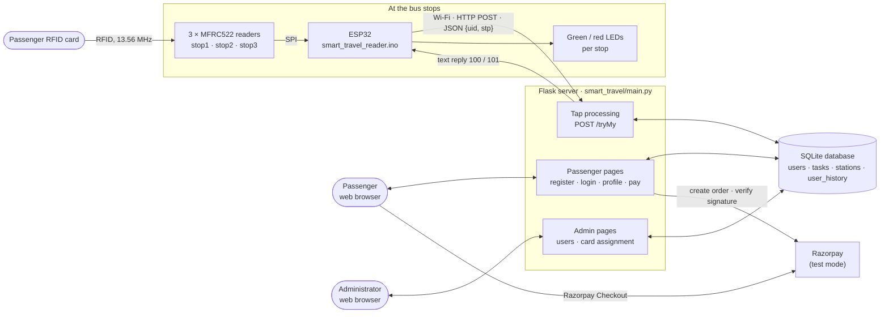
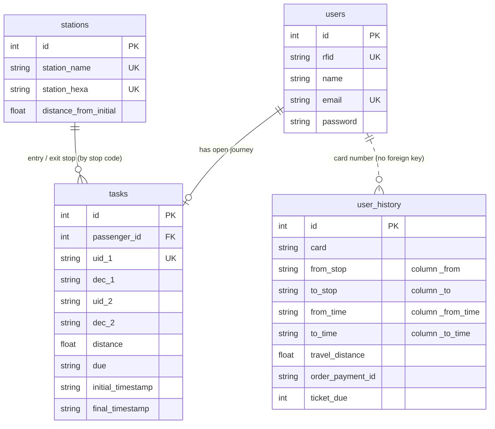
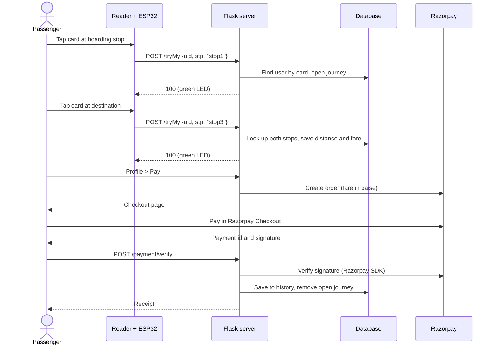
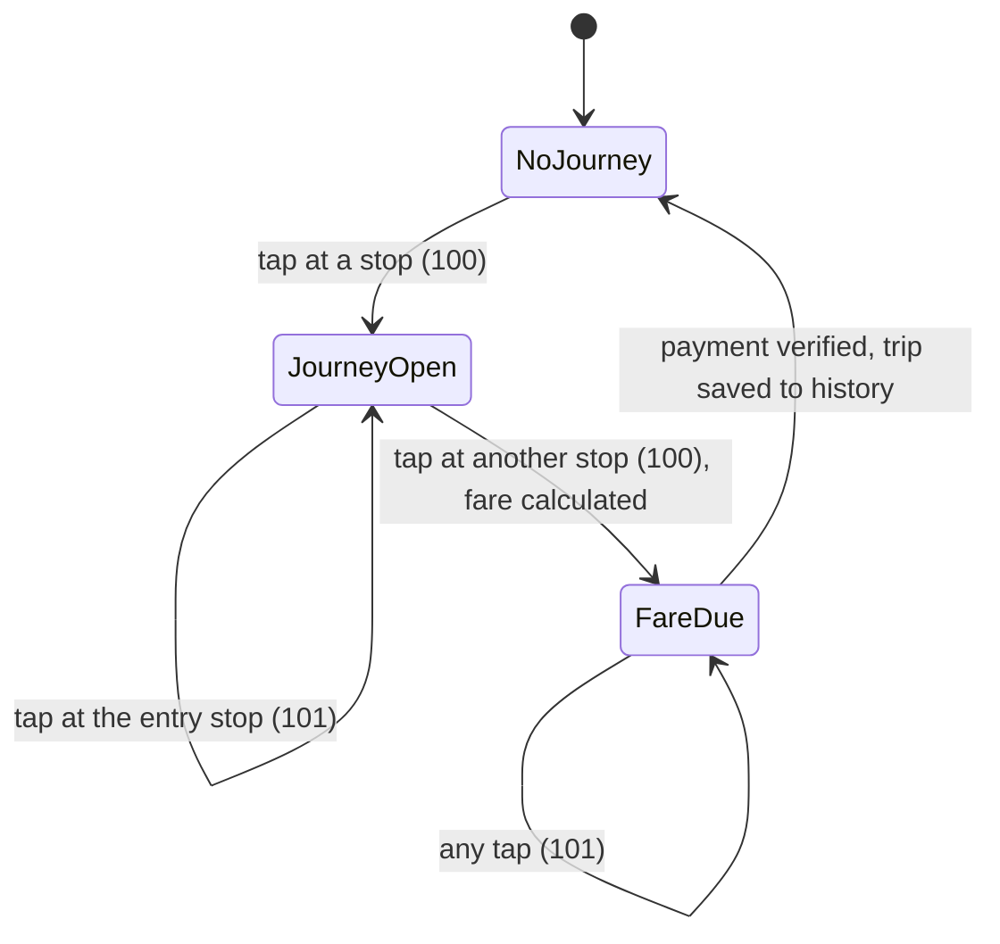
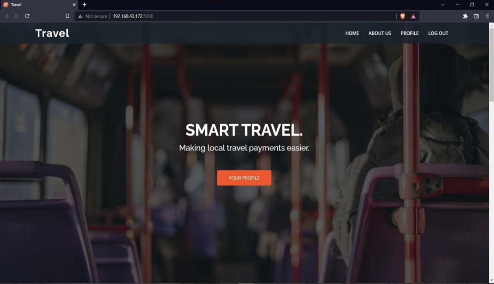
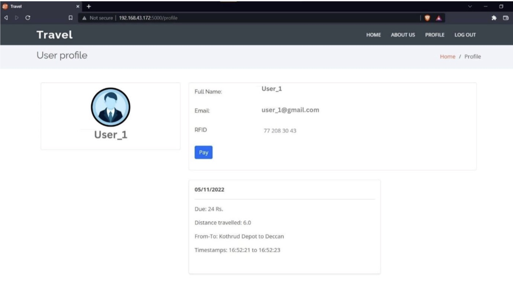
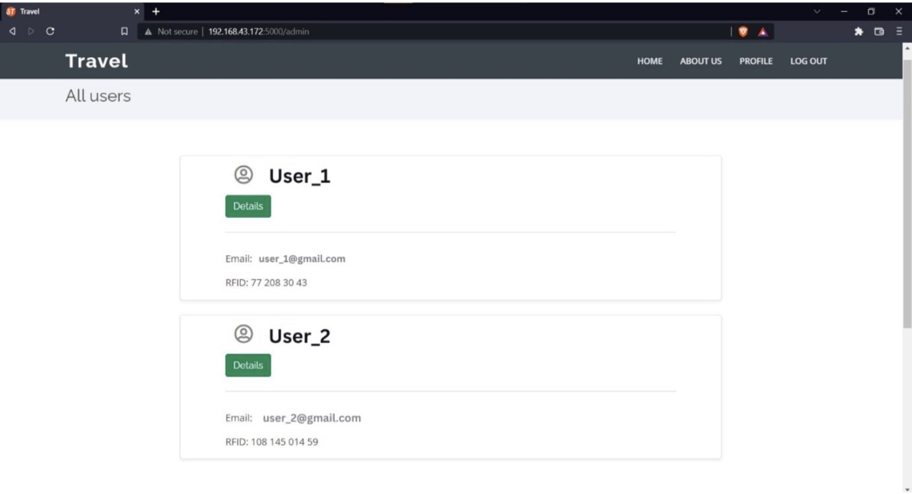

# Smart Travel – RFID-Based Automated Bus Ticketing System

Smart Travel is an IoT ticketing system for city buses. Passengers tap an RFID card at the stop where
they board and again where they get off. An ESP32 microcontroller reads the card with MFRC522 RFID
readers and sends each tap over Wi-Fi to a Flask server. The server identifies the passenger, records
the journey, calculates a distance-based fare and lets the passenger pay it online through Razorpay.
Passengers can see their travel history, and an administrator manages accounts and card assignments.



*The physical demonstration model built for the original project: a city route with RFID reader kiosks
and status LEDs at the stops.*

> **Historical implementation status:** Smart Travel was implemented and successfully demonstrated, with
> its hardware, as part of the original university project (2021–22). The physical hardware is currently
> at the university in India, so no end-to-end hardware demonstration has been carried out during the
> 2026 repository update. This documentation describes the implementation; reproducing the complete
> hardware and software setup today has not been independently re-verified. See
> [Implementation and testing status](#implementation-and-testing-status) for exactly what has and has not
> been re-tested.

## Contents

1. [Project overview](#project-overview)
2. [Key features](#key-features)
3. [System architecture](#system-architecture)
4. [Hardware requirements](#hardware-requirements)
5. [Technology stack](#technology-stack)
6. [Hardware and firmware](#hardware-and-firmware)
7. [Backend architecture](#backend-architecture)
8. [Routes and endpoints](#routes-and-endpoints)
9. [Database design](#database-design)
10. [Application workflow](#application-workflow)
11. [Fare calculation](#fare-calculation)
12. [Payment integration](#payment-integration)
13. [Repository structure](#repository-structure)
14. [Installation and setup](#installation-and-setup)
15. [Environment variables](#environment-variables)
16. [Running the project](#running-the-project)
17. [Screenshots](#screenshots)
18. [Security considerations](#security-considerations)
19. [Implementation and testing status](#implementation-and-testing-status)
20. [Known limitations](#known-limitations)
21. [Future enhancements](#future-enhancements)
22. [Project documentation](#project-documentation)
23. [Acknowledgements and project context](#acknowledgements-and-project-context)
24. [Licence](#licence)

## Project overview

### Background and motivation

City buses in India are mostly ticketed by hand: a conductor walks through the bus, collects cash and
issues a paper ticket for the distance the passenger intends to travel. The original project team, who
travelled to college by city bus, identified the problems this causes:

- Buying a ticket is difficult on crowded buses and on short trips, when the conductor may not reach every
  passenger in time.
- Passengers and conductors often lack change, and the balance is sometimes not returned.
- Every journey produces a paper ticket that is thrown away.
- Payment is cash-only, and there is no digital record of a passenger's journeys.
- The work is physically demanding for conductors.

### Proposed solution

Smart Travel replaces the paper ticket with a reusable RFID card linked to a passenger account:

1. Each stop has an RFID reader. Tapping the card when boarding records the entry stop and time.
2. Tapping the same card at the destination records the exit stop. The server calculates the distance
   between the two stops and the fare.
3. The fare is stored against the passenger's account as an outstanding payment. The passenger pays it
   online through Razorpay, which settles the trip and adds it to the travel history.

RFID suits this job because reading a card is contactless, needs no line of sight and works with cheap,
reusable cards. The ESP32 was chosen because it combines a microcontroller, an SPI interface for the
readers and built-in Wi-Fi to reach the server, on a single low-cost board.

### Objectives

- Identify passengers automatically at boarding and exit points using RFID cards.
- Calculate each fare from the distance actually travelled.
- Remove the need for cash and paper tickets.
- Record journeys and payments so passengers can review their travel history.
- Give an administrator tools to manage passengers and their cards.
- Integrate embedded hardware, a web backend, a database and a payment gateway into one working system.

### Scope

The project is a working prototype of a single bus route with four stops in the database and three
physical readers. It covers passenger identification, journey recording, fare calculation, online fare
payment in Razorpay test mode, passenger accounts and basic administration. Prepaid wallets, timetables,
GPS tracking and mobile apps were discussed in the original project documents but are outside the
implemented scope (see [Future enhancements](#future-enhancements)).

## Key features

| Feature | What the implementation does |
|---|---|
| RFID passenger identification | The card UID read at a stop is matched to the passenger account it is assigned to; unknown cards are rejected. |
| Boarding and exit stop identification | Each reader is fixed to one stop and sends that stop's code (`stop1`, `stop2`, …) with every tap. |
| Journey tracking | The first tap opens a journey with the entry stop and time; a tap at a different stop closes it with the exit stop and time. |
| Distance-based fare | Fare = distance between the two stops × ₹4 per km, rounded to the nearest rupee. |
| Tap validation | Tapping out at the entry stop, tapping at an unknown stop, and starting a new journey while a fare is unpaid are all rejected. |
| Immediate feedback at the stop | Each stop has a green LED (tap accepted) and a red LED (tap rejected), lit for two seconds. |
| Passenger accounts | Registration and login with hashed passwords; the profile shows the assigned card, any outstanding fare and the travel history. |
| Online fare payment | Razorpay order creation and Razorpay Checkout; the trip is settled after the payment signature is verified. |
| Receipts and travel history | A receipt is shown after payment; paid trips are listed on the profile with stops, times, distance and fare. |
| Administration | The administrator lists all users, assigns RFID cards and removes users. |
| Reader simulator | A command-line tool that sends the same requests as the ESP32, for demonstrations and testing without hardware. |

## System architecture



**Data flow**

1. **Card to ESP32.** A passenger holds the card to a reader. The MFRC522 reads the card's UID over
   13.56 MHz RFID, and the ESP32 polls all three readers over a shared SPI bus.
2. **ESP32 to server.** The ESP32 formats the UID as text and posts it, together with the stop code of
   that reader, to `/tryMy` as JSON over Wi-Fi.
3. **Server to database.** The server looks up the card and stop, opens or closes a journey in the
   `tasks` table, and calculates the fare when the journey closes.
4. **Server to ESP32.** The reply is the text `100` (accepted) or `101` (rejected); the ESP32 lights the
   green or red LED for that stop.
5. **Passenger, server and Razorpay.** The passenger logs in through a browser and pays the outstanding
   fare. The server creates a Razorpay order, the browser runs Razorpay Checkout, and the server verifies
   the result before moving the trip to `user_history`.

## Hardware requirements

| Component | Qty | Purpose | Source of this detail |
|---|---|---|---|
| ESP32 development board, documented as **ESP32-WROOM-32** | 1 | Reads the RFID readers, drives the LEDs and connects to the server over Wi-Fi | ESP32: firmware and project report. Module type: 2024 README |
| MFRC522 RFID reader module (13.56 MHz) | 3 | One reader per stop | Firmware (`MFRC522` library, three reader instances) |
| RFID cards, documented as **MIFARE Classic 1K** | 1 per passenger | Identify the passenger by card UID | Cards: firmware and project report. Card type: 2024 README |
| LEDs, green and red | 3 + 3 | Accepted / rejected feedback at each stop | Firmware (six LED pins); project report |
| LED resistors, documented as **220 Ω** | 6 | Limit LED current | 2024 README |
| Jumper wires, breadboard, USB cable | — | Connections, power and programming | 2024 README |

The module type, card type and resistor value come from an earlier version of the project README (2024).
They are not stated in the firmware or the project report and have not been confirmed independently. The
firmware is consistent with them: it uses the generic ESP32 libraries and reads a 4-byte card UID, as
MIFARE Classic 1K cards have.

**Pin assignments (from the firmware)**

| Signal | ESP32 GPIO |
|---|---|
| Reader 1 SS/SDA (`stop1`) | 21 |
| Reader 2 SS/SDA (`stop2`) | 22 |
| Reader 3 SS/SDA (`stop3`) | 2 |
| Reset, shared by all readers | 4 |
| SPI SCK / MISO / MOSI, shared | 18 / 19 / 23 (ESP32 default VSPI pins; the firmware calls `SPI.begin()` without arguments) |
| Reader power | 3.3 V and GND (the MFRC522 is a 3.3 V module) |
| `stop1` LEDs, green / red | 12 / 14 |
| `stop2` LEDs, green / red | 27 / 26 |
| `stop3` LEDs, green / red | 25 / 33 |

A wiring diagram and setup steps are in [hardware/README.md](hardware/README.md).

## Technology stack

| Category | Technology | Role |
|---|---|---|
| Languages | Python, C++ (Arduino), HTML, CSS, JavaScript, SQL | Server, firmware, web pages, database scripts |
| Backend | Flask | Web server, routing, templates |
| Database and ORM | SQLite, Flask-SQLAlchemy / SQLAlchemy | Data storage and queries |
| Authentication and forms | Flask-Login, Werkzeug password hashing, Flask-WTF / WTForms | Sessions, password hashing, form validation and CSRF tokens |
| Frontend | Jinja2 templates, Bootstrap 5, Flask-Bootstrap, BootstrapMade "Dewi" template, Font Awesome, Boxicons, Bootstrap Icons, Remix Icon | Page layout and styling |
| Payment | Razorpay Python SDK, Razorpay Checkout | Order creation, payment, signature verification |
| Embedded | ESP32 Arduino core (`WiFi`, `HTTPClient`), MFRC522 library, ArduinoJson | Firmware |
| Configuration | python-dotenv | Loads settings from `.env` |
| Communication | SPI, Wi-Fi, HTTP with JSON | Readers ↔ ESP32 ↔ server |
| Development tools | Arduino IDE, PyCharm (original development), pytest, GitHub Actions | Development and testing |

## Hardware and firmware

The firmware is [`hardware/smart_travel_reader/smart_travel_reader.ino`](hardware/smart_travel_reader/smart_travel_reader.ino).

**Start-up.** The ESP32 connects to the configured Wi-Fi network (it waits until connected), starts the
SPI bus, initialises the three MFRC522 readers and prints their firmware versions to the serial monitor
(115200 baud). It then sets the six LED pins as outputs.

**Reading cards.** `loop()` checks the three readers in turn. When a reader detects a new card, the
firmware reads the card's UID. Only the UID is used: no card memory is read or written. The card is then
halted, ready for the next tap.

**UID format.** The UID bytes are written as decimal numbers, each preceded by a space; bytes below 16
get an extra leading `0`. For example, the bytes `4D D0 1E 2B` become `" 77 208 30 43"`, and a byte value
of 14 is written as `014`. The server strips the spaces at the ends, so the value stored for the user is
`77 208 30 43`. Administrators enter card numbers in this format.

**Sending a tap.** Each reader has a fixed stop code (`stop1`, `stop2` or `stop3`). The firmware builds a
JSON document with ArduinoJson and posts it to the server URL from `config.h`:

```http
POST /tryMy HTTP/1.1
Content-Type: application/json

{"uid": " 77 208 30 43", "stp": "stop1"}
```

The reply body is the text `100` (accepted) or `101` (rejected). On `100` the stop's green LED lights for
two seconds; on any other reply, including an empty one when Wi-Fi is disconnected or the request fails,
the red LED lights. While an LED is lit, the other readers are not polled.

**Configuration.** Wi-Fi name, password and server URL are set in `config.h`, which is created from
[`config.example.h`](hardware/smart_travel_reader/config.example.h) and is not tracked by git.

## Backend architecture

The server is a single Flask application in [`smart_travel/main.py`](smart_travel/main.py), kept close
to its original structure:

| Part | Responsibility |
|---|---|
| Configuration | Loads `.env`, sets the session secret, chooses the database (`DATABASE_URL` or SQLite at `instance/travel.db`) |
| Models | `User`, `Task`, `Stations`, `UserHistory` (SQLAlchemy) |
| `init-db` command | Creates the tables and loads [`database/seed.sql`](database/seed.sql) |
| Tap processing | `/tryMy`: validates the request, opens or closes journeys, calculates fares |
| Fare calculation | `calculate_fare()` with the rate `FARE_PER_KM = 4` |
| Accounts | Registration, login, logout and profile, using Flask-Login and WTForms ([`forms.py`](smart_travel/forms.py)) |
| Administration | Users list, user details, card assignment and user removal, restricted by the `admin_only` decorator to the user with id 1 |
| Payment | Razorpay order creation, checkout page and signature verification |

Pages are Jinja2 templates in `smart_travel/templates/`; styles, scripts, images and third-party front-end
libraries are in `smart_travel/static/assets/`.

## Routes and endpoints

`/tryMy` is the only machine-to-machine endpoint. All other routes serve web pages or handle form
submissions from those pages.

| Route | Methods | Access | Purpose |
|---|---|---|---|
| **Reader endpoint** | | | |
| `/tryMy` | POST | Open (no authentication) | Receives a card tap as JSON `{"uid", "stp"}` and replies with the text `100` or `101` |
| **Public pages** | | | |
| `/` | GET | Anyone | Home page with an explanation of how the system works |
| `/about` | GET | Anyone | About the project |
| **Authentication** | | | |
| `/register` | GET, POST | Anyone | Registration form; logs the new user in |
| `/login` | GET, POST | Anyone | Login form |
| `/logout` | GET | Logged in | Ends the session |
| **Passenger** | | | |
| `/profile` | GET | Logged in | Account details, assigned card, outstanding fare, travel history |
| `/process_pay` | POST | Logged in | Creates a Razorpay order for the user's outstanding fare and shows the checkout page |
| `/payment/verify` | POST | Logged in | Receives the Razorpay Checkout result, verifies it and settles the trip |
| **Administrator** | | | |
| `/admin` | GET | Admin | All users and their card status |
| `/user_details?user_detail_id=<id>` | GET | Admin | One user's details, with the card assignment form |
| `/admin/add_rfid?user_id_for_rfid=<id>` | POST | Admin | Assigns a card UID (form field `rfid_value`) |
| `/admin/delete_user?user_id_to_delete=<id>` | GET | Admin | Removes a user and any open journey (the admin account cannot be removed) |

Some routes also accept methods that the pages never use (for example POST on `/about`); the table lists
the methods the application uses.

**Reader endpoint replies**

| Situation | Reply | Database change |
|---|---|---|
| Registered card, no open journey, known stop | `100` | New journey row with entry stop and time |
| Registered card, open journey, different known stop | `100` | Journey completed with exit stop, time, distance and fare |
| Card not assigned to any user | `101` | None |
| Stop code not in the `stations` table | `101` | None |
| Tap at the same stop as the entry | `101` | None (the journey stays open) |
| Previous journey's fare not yet paid | `101` | None |
| Missing or malformed JSON | `101` | None |

## Database design

The database is SQLite, accessed through SQLAlchemy. The tables are created automatically when the server
starts, and `flask --app smart_travel.main init-db` also loads the demonstration route and two demo
accounts. The schema and column names are unchanged from the original project, so older databases remain
compatible. Details: [database/README.md](database/README.md).



| Table | Role | Important fields |
|---|---|---|
| `users` | Passenger and administrator accounts | `rfid` (assigned card UID, unique), `email` (unique), `password` (PBKDF2-SHA256 hash). The user with id 1 is the administrator. |
| `stations` | Stops on the route | `station_hexa` is the stop code sent by the reader (despite the name, values such as `stop1`); `distance_from_initial` is the distance in km from the first stop |
| `tasks` | Journeys not yet paid for | `uid_1`/`dec_1`: card and entry stop; `uid_2`/`dec_2`: card and exit stop; `distance`, `due` (fare) and both timestamps. A row exists from the first tap until the fare is paid. |
| `user_history` | Completed, paid journeys | Card, stop names, times, distance, fare (`ticket_due`) and the Razorpay order id (`order_payment_id`) |

Stops are matched to journeys by their stop code, and paid journeys are matched to users by card number.
Neither relationship is a database foreign key.

**Demonstration route** (from [`database/seed.sql`](database/seed.sql); these are the stops shown in the
original screenshots):

| Stop code | Station | Distance from first stop |
|---|---|---|
| `stop1` | Kothrud Depot | 0.0 km |
| `stop2` | Anand Nagar | 2.7 km |
| `stop3` | Deccan | 6.0 km |
| `stop4` | Ma Na Pa | 9.3 km |

## Application workflow

### Passenger

1. **Register.** The passenger creates an account with name, email and password, and is logged in.
2. **Receive a card.** The administrator assigns an RFID card UID to the account (see below). Until then,
   the card is rejected at every reader.
3. **Board.** The passenger taps the card at the boarding stop. The server opens a journey with the entry
   stop and time; the green LED lights.
4. **Get off.** The passenger taps the same card at the destination stop. The server finds the open
   journey, calculates the distance and fare and stores them with the exit time; the green LED lights.
5. **Pay.** The passenger logs in and opens **Profile**, which shows the outstanding fare. **Pay** creates
   a Razorpay order and opens a checkout page; the passenger completes the payment in Razorpay Checkout.
6. **Settle.** The server verifies the payment, records the trip in the travel history, removes the open
   journey and shows a receipt. The card can now be used for the next journey.



### Administrator

The administrator is the account with user id 1 (in the seed data, `admin@smarttravel.local`). After
logging in, the **Admin** link opens the list of all users and shows whether each has a card. **Details**
opens one user: if no card is assigned, the administrator enters the card UID and clicks **Add RFID**; the
server rejects a UID that already belongs to someone else. **Remove user** deletes the account together
with any open journey; it is not offered for the administrator's own account.

## Fare calculation

**Distance.** Every stop has a fixed distance from the first stop of the route (`distance_from_initial`).
The distance travelled is the absolute difference between the values for the entry and exit stops, so
journeys in either direction are handled.

**Formula.** From `calculate_fare()` in `main.py`:

```python
distance_travelled = abs(round(end_km - start_km, 2))
ticket_cost = abs(round(distance_travelled * FARE_PER_KM, 0))   # FARE_PER_KM = 4
```

The rate of ₹4 per km is set in the code, and the same multiplier was used in the original 2022 code. The
journeys recorded in the original project databases match it (3.3 km → ₹13, 6.0 km → ₹24, 9.3 km → ₹37).
The project report does not state a rate; its fare table (Table 1.1) is an illustrative example.

**Example.** Anand Nagar (2.7 km) to Deccan (6.0 km): distance = 3.3 km, fare = 3.3 × 4 = 13.2, rounded to
**₹13**.

**When the fare is calculated and paid.** The fare is calculated on the exit tap and stored as an
outstanding amount on the journey. It is not deducted from a balance: the system has no prepaid wallet.
The passenger pays later through Razorpay, and cannot start another journey until that fare is paid. The
project report and an earlier repository description describe the fare as "automatically deducted from
the user's account"; that describes the original concept, not the implementation (see
[Project documentation](#project-documentation)).

**Invalid and incomplete journeys** are handled as listed under
[Reader endpoint replies](#routes-and-endpoints): an exit tap at the entry stop is rejected and the
journey stays open, and a journey without an exit tap stays open indefinitely. There is no time-out or
maximum fare.



## Payment integration

The original project used Razorpay **test-mode** keys, in which no real money is transferred. Live payment
was never configured, and this documentation assumes test-mode keys.

| Step | What happens | Where |
|---|---|---|
| Order creation | **Pay** on the profile page posts to `/process_pay`. The server takes the user's outstanding fare, creates a Razorpay order (amount in paise, currency INR, receipt `trip_<id>`) and remembers the order id in the user's session. | `process_pay()` |
| Payment | The checkout page loads Razorpay Checkout with the order id and the public key id. The passenger pays inside the Razorpay window. | `payment_checkout.html` |
| Verification | Razorpay returns the payment id, order id and signature to the browser, which posts them to `/payment/verify`. The server checks that the order id matches the one in the session and verifies the signature with the Razorpay SDK (`verify_payment_signature`). | `verify_payment()` |
| Success | The trip is copied to `user_history` with the Razorpay order id, the open journey is deleted, and a receipt shows the amount, order id, payment id, stops and times. | `verify_payment()`, `payment_receipt.html` |
| Failure or cancellation | If the payment fails, Razorpay Checkout reports the error and nothing is saved. If the window is closed or **Cancel** is clicked, the fare stays outstanding and **Pay** can be used again. A failed signature check or a mismatched order shows an error on the profile page and changes nothing. | Checkout page, `verify_payment()` |
| Not configured | Without `RAZOR_KEY` and `RAZOR_SECRET`, **Pay** shows a message that online payment is not configured. If Razorpay cannot be reached, an error message is shown. | `process_pay()` |

**Original behaviour and 2026 changes.** In the 2022 version, **Pay** created the Razorpay test-mode order
and immediately recorded the trip as paid and showed the receipt with the order id. The script meant to
open Razorpay Checkout contained template code in a static file and never ran, so no Checkout payment was
completed. The 2026 update added the checkout page and server-side signature verification described above.
These were tested with a simulated Razorpay client only; see
[Implementation and testing status](#implementation-and-testing-status).

## Repository structure

```text
.
├── smart_travel/                     Flask application
│   ├── main.py                       Configuration, models, routes, fare calculation, payment
│   ├── forms.py                      Registration and login forms
│   ├── templates/                    Jinja2 pages: home, about, login, register, profile, admin, payment
│   └── static/assets/                Template CSS and JavaScript, images, front-end libraries
├── hardware/
│   ├── README.md                     Components, wiring, reader protocol, firmware setup
│   └── smart_travel_reader/
│       ├── smart_travel_reader.ino   ESP32 firmware
│       └── config.example.h          Wi-Fi and server settings template
├── database/
│   ├── README.md                     Tables and database setup
│   ├── schema.sql                    Table definitions
│   └── seed.sql                      Demonstration route and demo accounts
├── tools/
│   └── simulate_reader.py            Sends ESP32-style card taps to the server
├── tests/                            Automated tests (tap handling, web pages, payment)
├── docs/
│   ├── screenshots/                  Photos and screenshots from the original project
│   └── recovery-log.md               Record of the 2026 recovery and restructuring
├── .github/workflows/tests.yml       Runs the tests on every push
├── .env.example                      Server configuration template
├── requirements.txt                  Runtime dependencies (pinned)
├── requirements-dev.txt              Runtime and test dependencies
├── pytest.ini                        Test settings
└── setup.cfg                         Linter settings
```

## Installation and setup

### Prerequisites

| Requirement | Needed for |
|---|---|
| Python 3.10 or newer (tested with 3.11) and `pip` | Server |
| Git | Cloning the repository |
| Arduino IDE with the ESP32 board package and the MFRC522 and ArduinoJson libraries | Firmware |
| ESP32 board, MFRC522 readers, RFID cards, LEDs (see [Hardware requirements](#hardware-requirements)) | Physical setup |
| A Wi-Fi network shared by the ESP32 and the server computer | Physical setup |
| Razorpay account with test-mode API keys | Online payment |

The server, database and simulator can be run without any hardware or Razorpay account.

### Server

```bash
git clone https://github.com/samu2421/City-transport-RFID-Based-Bus-Ticketing-Systems.git
cd City-transport-RFID-Based-Bus-Ticketing-Systems

python3 -m venv .venv
source .venv/bin/activate          # Windows: .venv\Scripts\activate

pip install -r requirements.txt

cp .env.example .env               # Windows: copy .env.example .env
# edit .env: set APP_SECRET, and RAZOR_KEY / RAZOR_SECRET if you want online payment

flask --app smart_travel.main init-db
```

`init-db` creates `instance/travel.db` with the four stops and two demo accounts. It can be run again
safely; existing rows are kept.

### Firmware and hardware

1. Wire the readers and LEDs as in [Pin assignments](#hardware-requirements) and
   [hardware/README.md](hardware/README.md).
2. In the Arduino IDE, install the **esp32** board package and the **MFRC522** and **ArduinoJson**
   libraries.
3. Copy `hardware/smart_travel_reader/config.example.h` to `config.h` in the same folder and set
   `WIFI_SSID`, `WIFI_PASSWORD` and `SERVER_URL` (`http://<server-computer-ip>:5000/tryMy`).
4. Open `smart_travel_reader.ino`, select the ESP32 board and port, and upload.
5. Open the serial monitor at 115200 baud and check that Wi-Fi connects and the three readers report a
   version.

### Payment

Create test-mode API keys in the Razorpay dashboard and put them in `.env` as `RAZOR_KEY` and
`RAZOR_SECRET`. Use only test-mode keys with this project.

## Environment variables

Settings are read from the environment or from `.env` in the project root. [`.env.example`](.env.example)
lists them with placeholder values. `.env` is excluded from git and must never be committed.

| Variable | Required | Description | Example placeholder |
|---|---|---|---|
| `APP_SECRET` | Yes | Secret key that signs login sessions. If unset, a temporary key is generated and sessions end when the server restarts. | output of `python -c "import secrets; print(secrets.token_hex(32))"` |
| `RAZOR_KEY` | For payment | Razorpay key id | `rzp_test_xxxxxxxxxxxx` |
| `RAZOR_SECRET` | For payment | Razorpay key secret | `xxxxxxxxxxxxxxxxxxxxxxxx` |
| `DATABASE_URL` | No | SQLAlchemy database URL; defaults to SQLite at `instance/travel.db` | `sqlite:////absolute/path/travel.db` |
| `FLASK_RUN_HOST` | No | Address used by `python -m smart_travel.main` (default `0.0.0.0`, all interfaces) | `0.0.0.0` |
| `FLASK_RUN_PORT` | No | Port (default `5000`) | `5000` |
| `FLASK_DEBUG` | No | `1` enables Flask debug mode (default off) | `0` |

The firmware's settings (`WIFI_SSID`, `WIFI_PASSWORD`, `SERVER_URL`) are in `config.h`, not `.env`.

## Running the project

**1. Start the server**

```bash
python -m smart_travel.main
```

It listens on all network interfaces on port 5000 and prints the addresses it can be reached on, for
example:

```text
 * Running on http://127.0.0.1:5000
 * Running on http://192.168.0.102:5000
```

The second address is the computer's address on the local network. The ESP32's `SERVER_URL` must use it.

**2. Open the web application** at `http://127.0.0.1:5000` and log in with a demo account:

| Role | Email | Password | Card UID |
|---|---|---|---|
| Administrator | `admin@smarttravel.local` | `admin123` | `77 208 30 43` |
| Passenger | `passenger@smarttravel.local` | `passenger123` | `108 145 014 59` |

The demo accounts are for local use only. The card UIDs are those of the two cards used with the original
hardware.

**3a. With the hardware:** power the ESP32 and tap a card at a reader. The server log shows each tap, for
example `Card tap: uid=108 145 014 59 stop=stop1`.

**3b. Without the hardware:** send the same requests with the reader simulator from a second terminal:

```bash
python tools/simulate_reader.py --card "108 145 014 59" stop1 stop3
```

```text
stop1: 100 accepted (green LED)
stop3: 100 accepted (green LED)
```

Log in as the passenger and open **Profile** to see the outstanding fare of ₹24 (Kothrud Depot to Deccan,
6 km).

## Screenshots

These screenshots and the photo of the model were taken during the original project (2021–22). The page
layouts are the same today. The current profile page also shows the outstanding fare, and the home and
about pages now describe the system instead of template placeholder text. No live deployment of the
system is available.

| Home page | Passenger profile and travel history |
|---|---|
|  |  |
| Landing page for a logged-in passenger. | Card number, **Pay** button and a completed trip (Kothrud Depot to Deccan, 6 km, ₹24). |

| Administrator dashboard | Demonstration model |
|---|---|
|  |  |
| All users with their assigned RFID cards. | City route model with reader kiosks and status LEDs. |

## Security considerations

**Implemented**

| Area | Mechanism |
|---|---|
| Passwords | Stored as PBKDF2-SHA256 hashes with a random salt (Werkzeug); plain-text passwords are never stored |
| Sessions | Flask-Login sessions in cookies signed with `APP_SECRET` |
| CSRF | Flask-WTF CSRF tokens on the registration and login forms |
| Access control | `login_required` on passenger routes; `admin_only` on administrator routes (logged-out visitors are redirected to login, other users get 403) |
| Database queries | SQLAlchemy ORM with parameterised queries |
| Output | Jinja2 auto-escaping in templates |
| Payment | Order amount fixed by the server; payment accepted only after Razorpay signature verification and a match with the order created for the logged-in user |
| Configuration | Secrets read from environment variables; `.env` and the firmware `config.h` are excluded from git; only placeholders are committed |
| Debug mode | Off unless `FLASK_DEBUG=1` |

**Limitations**

- **No HTTPS.** The server runs on Flask's development server over HTTP, and the ESP32 sends taps over
  plain HTTP. A deployment would need HTTPS and a production WSGI server.
- **Unauthenticated reader endpoint.** Any device on the network can post to `/tryMy` and record taps for
  a known card UID. Readers are not authenticated, and there is no rate limiting.
- **Card UIDs are not secret.** Passengers are identified by the card's UID alone, which can be read by any
  RFID reader and copied to another card.
- **Partial CSRF coverage.** The admin card form, the remove-user link (a GET request), the **Pay** button
  and the payment verification form have no CSRF tokens.
- **No payment reconciliation.** Settlement depends on the browser posting the Checkout result back. If
  the browser is closed after paying, Razorpay records the payment but the trip stays outstanding; there
  is no webhook, reconciliation or refund handling.
- **Single, fixed administrator** (user id 1), no password rules and no email verification.
- **Credentials from the original project** (Razorpay test keys and a hosted-database URL) were stored in a
  local `.env` file that is not part of this repository; they should be treated as compromised and revoked.

## Implementation and testing status

**Historical implementation.** The overall system was implemented and successfully demonstrated on the
physical model during the original university project, as confirmed by the project team, and it received
awards at project exhibitions (see [Acknowledgements and project context](#acknowledgements-and-project-context)).
The table below lists the specific historical evidence for each part of the system. The original project
databases and setup slides it refers to are kept privately because they contain personal data.

The columns mean:

- **Historical evidence (2021–22):** what the original project materials show for that feature.
- **In current source code:** the code in this repository contains the implementation.
- **2026 automated tests:** covered by the test suite run during the 2026 repository update. These tests
  exercise the server only, with the hardware and Razorpay simulated.
- **Hardware or live service:** whether it was run again on the physical hardware or against Razorpay
  during the 2026 update.

| Area | Historical evidence (2021–22) | In current source code | 2026 automated tests | Hardware or live service |
|---|---|---|---|---|
| Card reading, stop identification, LED feedback | Demonstration model with reader kiosks and LEDs (photo); journeys recorded with entry and exit stops in the original databases | Yes (firmware) | No; the firmware was not compiled | Not re-tested |
| Tap processing and journey tracking | Journeys with stops and timestamps in the original databases | Yes | Yes, with simulated taps | Not re-tested with readers |
| Fare calculation (₹4/km) | Recorded fares in the original databases match the formula | Yes | Yes | Not applicable |
| Accounts, profile and travel history | Profile screenshot with card number and a completed trip | Yes | Yes | Not applicable |
| Administrator user list and card assignment | Administrator dashboard screenshot showing users with assigned cards; procedure described in the setup slides | Yes | Yes | Not applicable |
| Removing users | Procedure described in the setup slides | Yes | Yes | Not applicable |
| Razorpay order creation (test mode) | Razorpay order ids stored with the trips in the original databases | Yes | Yes, with Razorpay simulated | No new test-mode transaction |
| Razorpay Checkout and signature verification | None; added in 2026 | Yes | Yes, with Razorpay simulated | Not tested against Razorpay |
| `init-db` seeding and reader simulator | None; added in 2026 | Yes | Yes | Not applicable |

**2026 repository update.** The code was recovered from project backups, restructured and updated to
current versions of its Python dependencies (the changes are listed in
[docs/recovery-log.md](docs/recovery-log.md)). During this update:

- The automated test suite (41 tests) passed. It covers tap handling with the exact JSON the firmware
  sends, fare calculation, validation rules, web pages, account and admin functions, and the payment flow
  with Razorpay simulated.
- The server was run end-to-end with the reader simulator sending taps over HTTP.
- The firmware was edited but **not compiled**, and no hardware test was carried out, because the hardware
  is at the university.
- No Razorpay test-mode transaction was made.

Reproducing the complete hardware and software system from this repository has therefore not been
independently re-verified.

**Running the tests**

```bash
pip install -r requirements-dev.txt
pytest
```

| Test file | Covers |
|---|---|
| `tests/test_tap_flow.py` | Fare calculation; tap-in and tap-out; unknown card and stop; same-stop exit; unpaid fare; malformed requests |
| `tests/test_web.py` | Pages and static files; registration and login; profile; admin access control, card assignment, duplicate cards, user removal |
| `tests/test_payment.py` | Order creation in paise; signature verification; rejected and mismatched payments; gateway errors; settlement into history |

GitHub Actions runs the tests on every push ([`.github/workflows/tests.yml`](.github/workflows/tests.yml)).

## Known limitations

- **Hardware availability:** the physical hardware is at the university, and the current firmware has not
  been compiled or run on it.
- **External credentials:** online payment needs the developer's own Razorpay test-mode keys.
- **Three readers, four stops:** the firmware drives `stop1` to `stop3`; `stop4` in the seed data can only
  be reached with the simulator. Adding a stop means adding a reader in the firmware and a row in
  `stations`.
- **Blocking firmware:** while an LED is lit (two seconds), no reader is polled, and the ESP32 waits
  indefinitely for Wi-Fi at start-up.
- **One open journey per card:** a passenger must pay before boarding again, and an unfinished journey has
  no time-out.
- **Travel history is linked by card number,** so a reassigned card shows its earlier trips to the new
  owner.
- **Prototype infrastructure:** Flask's development server, SQLite without migrations, and timestamps
  stored as text.
- **External resources:** pages load fonts, icons and Bootstrap from public CDNs, and Razorpay Checkout
  needs internet access.
- The security limitations listed under [Security considerations](#security-considerations).

## Future enhancements

None of these are implemented.

From the original project documents:

- **Real-time GPS** to locate buses and passengers instead of fixed stops.
- **An Android application** for passengers.
- **Real-time bus scheduling** based on passenger location.
- **Bus routes and timetables** on the website.
- **A prepaid wallet** with automatic fare deduction.

Technical improvements:

- Authenticated readers (for example a per-device key) over HTTPS, and rate limiting on `/tryMy`.
- Razorpay webhooks for payment reconciliation, and refund handling.
- CSRF protection on every form, and a role field for administrators.
- Linking travel history to user ids; database migrations; a production server and hosted database.
- Non-blocking firmware and Wi-Fi reconnection.

## Project documentation

| Document | Contents |
|---|---|
| [hardware/README.md](hardware/README.md) | Components, wiring diagram, pin table, reader protocol, firmware setup |
| [database/README.md](database/README.md) | Tables, database creation, adding stops |
| [database/schema.sql](database/schema.sql), [database/seed.sql](database/seed.sql) | Table definitions from the original database; demonstration route and demo accounts |
| [docs/recovery-log.md](docs/recovery-log.md) | How the project was recovered and restructured in 2026, and every change to the code |
| [.env.example](.env.example), [config.example.h](hardware/smart_travel_reader/config.example.h) | Configuration templates for the server and the firmware |

**Original project documents.** The project report, synopsis and setup presentation are not included in
this repository because they contain personal details of team members (university seat numbers and
account credentials).

**Differences between the original documents and the implementation**

| Original document says | Implementation |
|---|---|
| The ESP32 sends scan data to the web application "via Bluetooth" (report, Table 4.2) | Wi-Fi with HTTP POST requests |
| The fare is "automatically deducted" from the user's account after money is added to it (report, concept note) | The fare is recorded as an outstanding amount and paid afterwards through Razorpay; there is no wallet |
| The home page shows bus routes and timetables (report) | Not implemented |
| Fingerprint authentication (early concept note) and DC motors (synopsis) | Not part of the implementation |
| Sample fare table charging 10 per route section of length *r* (report, Table 1.1) | An illustrative example; the implemented rate is ₹4 per km |
| Bootstrap 4 (report, synopsis) | Bootstrap 5.1.3 |

## Acknowledgements and project context

Smart Travel was developed as a Project Based Learning-II team project in the Department of Artificial
Intelligence and Data Science, PES's Modern College of Engineering, Pune (Savitribai Phule Pune
University), in the academic year 2021–22, under the guidance of **Prof. Priyanka Deshpande**. The
project report was titled "City transport: RFID-Based Bus Ticketing Systems".

**Project team:** Aditya Ladawa, Samiksha Dhere, Yash Wadekar, Sayee Aher, Tushar Pawar.

**Recognition:** The project received awards at project exhibitions.
<!-- TODO (repository owner): add the award name, exhibition or event, organiser and year for each award. -->
*Award details to be added.*

**Third-party work:** the website is based on the free
[Dewi template by BootstrapMade](https://bootstrapmade.com/dewi-free-multi-purpose-html-template/). The
project also uses Flask, SQLAlchemy, Razorpay's SDK and Checkout, the MFRC522 and ArduinoJson libraries,
the ESP32 Arduino core, and the front-end libraries listed under [Licence](#licence).

## Licence

No licence has been chosen for this repository yet. Until one is added, the default copyright rules apply:
the code may be viewed, but permission is needed to reuse it.

Third-party components keep their own licences:

| Component | Location | Licence |
|---|---|---|
| Dewi template (BootstrapMade) | `static/assets/css/style.css`, `static/assets/js/main.js`, page layouts | [BootstrapMade licence](https://bootstrapmade.com/license/): the footer credit must stay |
| Bootstrap 5 | `static/assets/vendor/bootstrap/` | MIT |
| Bootstrap Icons, Boxicons, AOS, GLightbox, Swiper, PureCounter | `static/assets/vendor/` | MIT |
| Remix Icon 2.5.0 | `static/assets/vendor/remixicon/` | Apache 2.0 |
| Background and illustration images | `static/assets/img/` | Origin not recorded; supplied with the template or collected during the original project |
