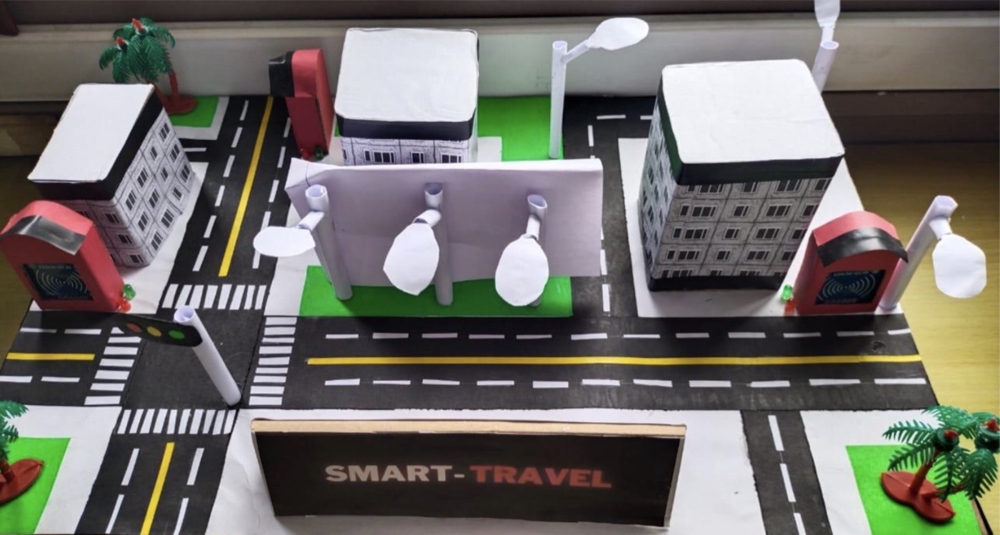
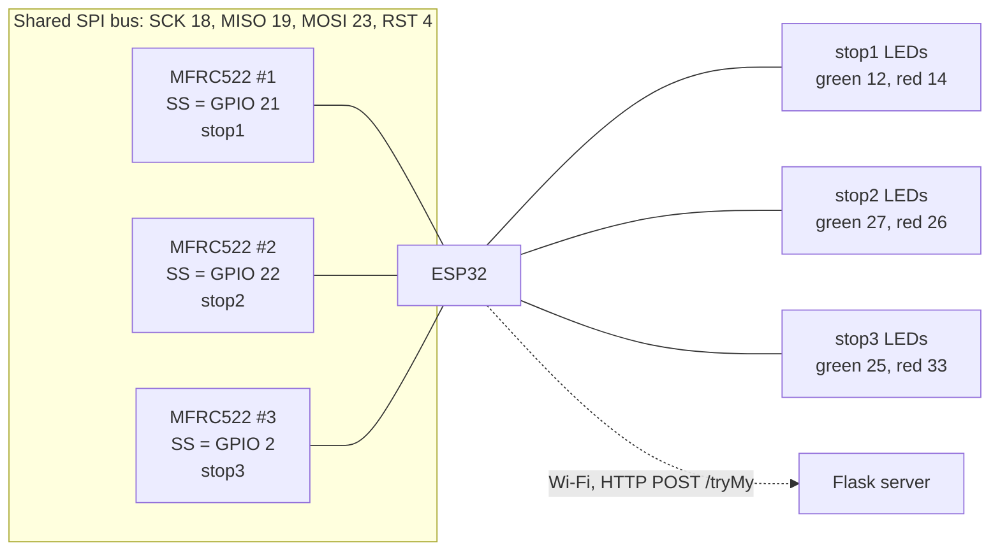

# Hardware: ESP32 RFID reader

The firmware in [`smart_travel_reader/`](smart_travel_reader/) runs on an ESP32 with three MFRC522 RFID
readers. Each reader stands for one bus stop. When a card is tapped, the ESP32 sends the card UID and the
stop code to the Flask server over Wi-Fi and lights a green or red LED for that stop depending on the reply.



*The demonstration model: a city route with RFID reader kiosks and status LEDs at the stops.*

## Components

| Component | Quantity | Notes |
|---|---|---|
| ESP32 development board, documented as ESP32-WROOM-32 | 1 | Wi-Fi is used to reach the server |
| MFRC522 RFID reader module (13.56 MHz) | 3 | One per stop (`stop1`, `stop2`, `stop3`) |
| RFID cards, documented as MIFARE Classic 1K | 1 per passenger | The 4-byte UID identifies the passenger |
| LEDs, green and red | 3 + 3 | One pair per stop |
| LED resistors, documented as 220 Ω | 6 | One per LED |
| Jumper wires, breadboard, USB cable | | Connections, power and programming |

The ESP32 module type, card type and resistor value are taken from an earlier version of the project
README (2024). They are not stated in the firmware or the project report and have not been confirmed
independently. Everything else in this file comes from the firmware.

## Pin connections

These are the pins defined in `smart_travel_reader.ino`.

| Signal | ESP32 GPIO | Notes |
|---|---|---|
| Reader 1 SDA/SS (`stop1`) | 21 | |
| Reader 2 SDA/SS (`stop2`) | 22 | |
| Reader 3 SDA/SS (`stop3`) | 2 | |
| RST (all readers) | 4 | Shared reset line |
| SCK, MISO, MOSI (all readers) | 18, 19, 23 | Default VSPI pins; the sketch calls `SPI.begin()` without arguments |
| Reader VCC / GND | 3.3 V / GND | The MFRC522 is a 3.3 V device |
| `stop1` LED green / red | 12 / 14 | |
| `stop2` LED green / red | 27 / 26 | |
| `stop3` LED green / red | 25 / 33 | |



## Communication protocol

For every tap the ESP32 sends:

```http
POST /tryMy HTTP/1.1
Content-Type: application/json

{"uid": " 77 208 30 43", "stp": "stop1"}
```

- `uid` is the card UID written as decimal bytes, each preceded by a space (bytes below 16 get a leading
  `0`, e.g. 14 is sent as `014`). The server strips the surrounding spaces, so the value stored for the
  user is `77 208 30 43`.
- `stp` is the stop code of the reader that was tapped. It must match `station_hexa` in the `stations`
  table.
- The server replies with the text `100` (accepted: green LED) or `101` (rejected: red LED). Any other
  reply, including a network error, also lights the red LED.

The USB serial port (115200 baud) is used only for debug output.

## Setup

1. Install the [Arduino IDE](https://www.arduino.cc/en/software) and add ESP32 support: add
   `https://raw.githubusercontent.com/espressif/arduino-esp32/gh-pages/package_esp32_index.json` under
   **File > Preferences > Additional boards manager URLs**, then install **esp32** from the Boards Manager.
2. Install these libraries from **Tools > Manage Libraries**:
   - **MFRC522** (by GithubCommunity)
   - **ArduinoJson** (by Benoit Blanchon). The sketch uses `DynamicJsonDocument`, which is the version 6
     API; version 7 still accepts it but marks it as deprecated.
3. Copy `smart_travel_reader/config.example.h` to `smart_travel_reader/config.h` and set your Wi-Fi name,
   password and the server address. The server must be on the same network as the ESP32; when you start it
   with `python -m smart_travel.main`, it prints the address to use (for example
   `Running on http://192.168.0.102:5000`).
4. Open `smart_travel_reader/smart_travel_reader.ino`, select your ESP32 board and port under **Tools**,
   and upload.
5. Open the Serial Monitor at 115200 baud. You should see `Initialize System`, then the reader versions
   once Wi-Fi is connected. Tap a card that is assigned to a user and check that the green LED lights.

## Implementation status

- **Historical implementation:** the firmware ran on the physical demonstration model during the original
  university project (2021–22), where the system was successfully demonstrated.
- **2026 changes:** Wi-Fi and server settings moved to `config.h`, the read functions no longer call
  themselves recursively, and `sendData()` returns an empty reply when Wi-Fi is down (so the red LED
  lights). Unused code (a fourth reader and a request to a server route that does not exist) was removed.
- **Not re-tested:** the hardware is at the university, so the changed firmware has **not been compiled
  or run on the hardware**, and the wiring above has not been re-checked against the physical model.

Without the hardware, [`tools/simulate_reader.py`](../tools/simulate_reader.py) sends the same requests to
the server. This tests the server's handling of taps, not the firmware or the readers. See
[Implementation and testing status](../README.md#implementation-and-testing-status) in the main README.
